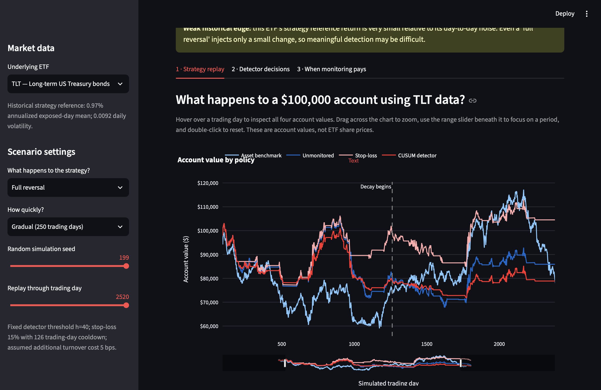

# Oxhack-F — Trading Strategy Deterioration Monitor

**When should a trading strategy be reduced, paused, or left alone?**

Oxhack-F is an interactive research prototype exploring how statistical change detection can inform risk-management decisions when a trading strategy's expected performance deteriorates.

The project uses historical ETF data, controlled simulations of strategy deterioration, and a CUSUM-based monitoring rule to compare three approaches:

- **Unmonitored:** Continue trading regardless of underperformance.
- **Stop-loss:** Pause trading when the strategy experiences a sufficiently large drawdown.
- **CUSUM detector:** Adjust exposure based on accumulating evidence that the strategy's expected return has deteriorated.

An interactive Streamlit dashboard visualises the decisions and their consequences across different market datasets and simulated conditions.

**Project type:** Solo hackathon prototype  
**Theme:** Best use of data for predictions and decision-making  
**Technology:** Python, NumPy, pandas, Plotly, Streamlit, pytest

---

## 1. The problem

Trading strategies don't necessarily remain effective indefinitely.

Market conditions change, and an approach that performed well historically may become less profitable or begin losing money.

However, ordinary fluctuations make it difficult to determine whether a strategy is experiencing:

- Normal short-term losses.
- A temporary period of underperformance.
- A reduction or disappearance of its expected return.
- A reversal, where its previously positive expected return becomes negative.

This creates a decision problem.

**Reducing exposure too early** can sacrifice returns from a strategy that remains effective.

**Reacting too late** can expose a portfolio to prolonged losses from a strategy whose edge has deteriorated.

The objective of Oxhack-F is to investigate this tradeoff quantitatively.

Instead of assuming that monitoring is always beneficial, the project asks:

> Under what conditions does the benefit of monitoring strategy deterioration outweigh the cost of false alarms and reduced exposure?

## 2. The approach

Oxhack-F implements a simple long/flat trading strategy, introduces controlled changes to its expected returns, and evaluates how alternative monitoring policies respond.

The experimental pipeline consists of five stages.

### Stage 1 — Historical market data

The project uses locally cached, adjusted historical price data for three exchange-traded funds:

| Ticker | Asset class | Description |
|---|---|---|
| SPY | US equities | ETF tracking the S&P 500 |
| TLT | US government bonds | ETF tracking long-term US Treasury bonds |
| GLD | Gold | Physically backed gold ETF |

Data was obtained using the `yfinance` Python library and is cached in `data/raw/`.

SPY is the primary calibration and evaluation dataset. TLT and GLD provide additional exploratory demonstrations across asset classes.

### Stage 2 — Baseline trading strategy

The underlying strategy uses a 200-day simple moving average (SMA).

- If the closing price is above the 200-day SMA, the strategy takes a long position.
- Otherwise, it remains out of the market.
- Trading signals are calculated at the close of each day and applied from the following trading day.

This one-day shift prevents the backtest from acting on information before it becomes available.

The backtest assumes a transaction cost of **5 basis points per unit of position change** and an initial account value of **$100,000**.

The strategy was selected for simplicity and interpretability, not because it represents a proven source of abnormal risk-adjusted returns.

### Stage 3 — Simulated strategy deterioration

To evaluate detection performance, the project generates synthetic scenarios using a 40-day block bootstrap of historical strategy observations.

An artificial change is then introduced into the strategy's expected returns at a known point.

Each scenario covers approximately 10 trading years (2,520 trading days), with deterioration introduced halfway through the simulation.

The tested deterioration severities are:

| Decay depth | Interpretation |
|---|---|
| 0.0 | No deterioration |
| 0.5 | Half of the expected edge disappears |
| 1.0 | Expected edge falls to zero |
| 1.5 | Expected edge partially reverses |
| 2.0 | Expected edge fully reverses |

Changes can occur suddenly over one trading day or gradually over 250 trading days.

Because the simulation specifies when and how severely deterioration occurs, detection performance can be measured against known ground truth.

**Important modelling distinction:** The artificial deterioration is injected into strategy returns, not directly into the underlying asset prices. Historical positions and returns are resampled together; the SMA signal is not recomputed on each synthetic price path.

This is a controlled strategy-return experiment, not a complete simulation of a trading system operating in a newly generated market.

### Stage 4 — Statistical change detection

The detector uses a one-sided **Cumulative Sum (CUSUM)** statistic to accumulate evidence that the strategy's mean return has fallen below its historical reference.

The statistic updates on days when the underlying strategy is exposed to the market. Days when the strategy is flat do not provide new information about its exposed-day return edge.

The monitoring policy uses a threshold of `h = 40`:

| CUSUM statistic | Strategy size |
|---|---|
| Below 20 | 100% |
| From 20 to below 40 | 50% |
| 40 or above | 0% (paused) |

The detector continues monitoring the paper strategy's returns even while the actual trading strategy is paused, allowing exposure to recover if the statistic falls.

The threshold was selected using separate calibration simulation seeds on SPY. It is held fixed during the reported evaluation.

### Stage 5 — Policy comparison

The CUSUM detector is compared against two baselines:

**Unmonitored strategy**

The original strategy runs without an additional deterioration-monitoring rule.

**Drawdown stop-loss**

The strategy pauses after its paper account experiences a 15% drawdown, with a 126-trading-day cooldown.

**CUSUM-monitored strategy**

The strategy adjusts exposure according to the accumulated evidence of deteriorating returns.

Each policy is evaluated on the same simulated strategy scenario to allow paired comparisons.

Key evaluation metrics include total return, Sharpe ratio, maximum drawdown, severe-tail drawdowns, and the proportion of simulations in which a monitored policy finishes ahead of the unmonitored baseline.

---

## 3. Experimental results

The main SPY evaluation used 200 simulation seeds, held separate from the seeds used for detector calibration.

The table reports results for sudden deterioration scenarios.

| Scenario | Detector return difference | Worst-5% drawdown improvement | Detector beats unmonitored |
|---|---:|---:|---:|
| No deterioration | −14.0 pp | +9.6 pp | 6.5% |
| Half the edge disappears | −12.9 pp | +12.2 pp | 11.5% |
| Edge falls to zero | −8.5 pp | +18.0 pp | 31.5% |
| Partial edge reversal | +6.5 pp | +25.3 pp | 64.0% |
| Full edge reversal | +27.3 pp | +33.8 pp | 91.5% |

*pp = percentage points. Return differences are the median of paired 10-year total-return differences. Drawdown improvements represent differences in the fifth percentile of maximum drawdown, where positive values indicate shallower severe drawdowns.*

### Finding 1 — Monitoring has a measurable cost

When no deterioration occurs, the CUSUM-monitored strategy produces a median paired total-return difference of −14.0 percentage points relative to the unmonitored strategy.

The detector finishes ahead in only 6.5% of these simulations.

Monitoring is therefore not automatically beneficial, even when it reduces exposure to risk.

### Finding 2 — Mild deterioration is difficult to justify monitoring on returns alone

When the strategy's expected edge falls to zero, monitoring does not improve median total returns in this experiment.

Although severe drawdowns become shallower, the detector sacrifices returns through reduced exposure.

This indicates that the value of monitoring depends on the risk-management objective, rather than only on final account value.

### Finding 3 — Monitoring becomes beneficial under severe deterioration

When the expected strategy edge partially or fully reverses, the detector begins outperforming the unmonitored strategy on median paired returns.

In the sudden full-reversal scenario:

- The median paired return improvement is approximately 27.3 percentage points.
- The worst-5% maximum drawdown improves by approximately 33.8 percentage points.
- The monitored strategy finishes ahead in 91.5% of simulated runs.

Gradual full reversal also favours monitoring, although less strongly: its median paired return improvement is 20.8 percentage points.

### Finding 4 — The benefit depends on deterioration severity

The experiment identifies a change in the detector's cost-benefit balance as deterioration becomes more severe.

For the tested SPY scenarios, the median paired return advantage changes from negative to positive somewhere between decay depths 1.0 and 1.5.

This is an observed boundary within the chosen simulation model, not a universal threshold applicable to real trading strategies.

**Overall conclusion:** In the tested scenarios, CUSUM-based monitoring provides tail-risk protection but incurs a return cost when strategy deterioration is absent or mild. Its strongest return benefits appear when the strategy's expected edge reverses.

---

## 4. Interactive dashboard

Oxhack-F includes a Streamlit application for exploring the simulations and comparing policy decisions.

The dashboard provides three main views.

### Panel 1 — Strategy replay

Displays account-value curves for:

- The underlying asset benchmark.
- The unmonitored strategy.
- The drawdown stop-loss strategy.
- The CUSUM-monitored strategy.

Users can select an ETF, deterioration scenario, deterioration speed and random seed.

Interactive Plotly charts support hovering over account values, zooming, panning and selecting specific time ranges.

### Panel 2 — Detector decisions

Displays the CUSUM statistic and its decision thresholds alongside the strategy's exposure.

This makes it possible to inspect when the monitoring rule reduces or restores exposure.

Monitoring decisions are applied with a one-trading-day delay, so the policy does not act on information from the future.

### Panel 3 — When monitoring pays

Displays heatmaps comparing the detector and stop-loss against the unmonitored baseline across deterioration depths and speeds.

The charts show changes in returns, severe drawdowns and the proportion of simulations in which monitoring finishes ahead.

---

## 5. Getting started

### Prerequisites

- Python and pip
- A terminal, such as the integrated terminal in VS Code
- A web browser

### Clone the repository

```bash
git clone https://github.com/nothingwastakenSoCallMeT/Oxhack-F.git
cd Oxhack-F
```

### Create and activate a virtual environment

On macOS or Linux:

```bash
python3 -m venv .venv
source .venv/bin/activate
```

### Install dependencies

```bash
python -m pip install -r requirements.txt
python -m pip install plotly
```

The separate Plotly installation is necessary if using the current interactive-dashboard version before `plotly` is added to `requirements.txt`.

### Launch the dashboard

```bash
python -m streamlit run app.py
```

Open `http://localhost:8501` in a browser if it doesn't open automatically.

The dashboard uses locally cached price data, so downloading fresh market data is not required.

### Run the tests

From the repository root:

```bash
python -m pytest -q
```

The current test suite contains 10 tests covering core backtest, scenario and monitoring behaviours.

### Reproduce the main evaluation

The `test.ipynb` notebook contains the development and evaluation workflow.

The scenario grid can also be reproduced with:

```python
import pandas as pd
from src.backtest import run_backtest
from src.grid import monitoring_grid

prices = pd.read_csv(
    "data/raw/SPY.csv",
    index_col="date",
    parse_dates=True,
)

res = run_backtest(prices["Close"])

grid = monitoring_grid(
    res,
    h=40,
    n_seeds=200,
    seed0=0,
)

print(grid.to_string(index=False))
```

Using the same cached data, code and random seeds is important for reproducing the reported results.

---

## 6. Project structure

```text
Oxhack-F/
├── app.py                  # Interactive Streamlit dashboard
├── README.md
├── dashboard.png
├── requirements.txt
├── test.ipynb              # Experimentation and analysis
├── data/
│   └── raw/
│       ├── SPY.csv
│       ├── TLT.csv
│       └── GLD.csv
├── src/
│   ├── data.py             # Market data acquisition/loading
│   ├── backtest.py         # SMA strategy and performance metrics
│   ├── scenarios.py        # Bootstrap and edge-deterioration scenarios
│   ├── policies.py         # CUSUM and stop-loss decision rules
│   ├── evaluate.py         # Detector evaluation and policy comparisons
│   └── grid.py             # Multi-scenario evaluation
└── tests/
    ├── test_backtest.py
    ├── test_scenarios.py
    ├── test_policies.py
    └── test_grid.py
```

## 7. Limitations

Oxhack-F is an experimental prototype. Its results should not be interpreted as evidence of profitable live trading performance.

Several limitations matter:

**Synthetic deterioration:** Changes in expected strategy returns are injected according to predetermined assumptions. Real strategy deterioration may behave differently.

**Historical reference-edge estimation:** The detector's reference return is estimated using the same historical strategy data underlying the simulated scenarios. This gives the detector a favourable reference and does not constitute independent out-of-sample validation.

**Bootstrap approximation:** The simulation resamples historical positions and returns rather than recalculating the trading strategy on new synthetic price histories. This limits the realism of the generated scenarios.

**Approximate transaction costs:** The backtest and policy comparisons use simplified cost assumptions rather than a complete execution model.

**Cross-asset calibration:** The CUSUM threshold was calibrated on SPY and reused for TLT and GLD. Results on these additional assets are exploratory.

**Limited strategy coverage:** Only a simple moving-average strategy is considered. Results may differ for other trading strategies, particularly those with different turnover, volatility and return characteristics.

**Statistical uncertainty:** Results are estimated from finite Monte Carlo samples. Small differences may not be statistically meaningful.

The project demonstrates the behaviour of a monitoring rule under controlled assumptions. It does not establish that the detector can reliably distinguish ordinary drawdowns from real alpha decay in live financial markets.

## 8. Future development

Potential extensions include:

- **Walk-forward evaluation:** Estimate detector parameters using one historical period and evaluate on later, unseen periods.
- **More realistic simulations:** Recompute trading signals on newly generated price paths rather than resampling historical positions.
- **Improved transaction modelling:** Account for execution costs and turnover more completely.
- **Additional baselines:** Compare CUSUM with rolling statistical tests and other risk-management policies.
- **Sensitivity analysis:** Investigate how results change across detector thresholds, strategy definitions and market conditions.
- **Uncertainty estimates:** Quantify confidence intervals around reported policy-performance differences.
- **Regime-aware monitoring:** Investigate whether distinguishing temporary unfavourable conditions from permanent strategy deterioration improves decisions.

These extensions are not part of the current validated prototype.

## 9. License

This project is released under the MIT License. See [LICENSE](LICENSE).

---

**Disclaimer:** Oxhack-F is an educational research prototype developed for a hackathon. It is not financial advice, a production trading platform or a validated investment strategy.
